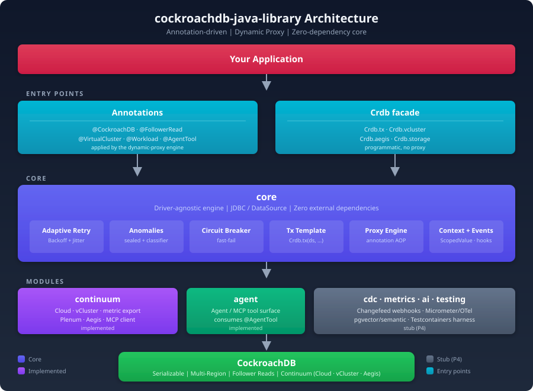

# CockroachDB Java Library

[](https://github.com/cockroachlabs/cockroachdb-java-library/actions/workflows/ci.yml)
[](https://github.com/cockroachlabs/cockroachdb-java-library/releases)
[](LICENSE)

A **pure-Java**, framework-free library for CockroachDB. Its headline feature:
custom annotations plus runtime dynamic proxies that make CockroachDB
anomaly-handling boilerplate — the `try/catch` retry loops around serialization
errors (SQLSTATE `40001`) — **disappear**.

It is the framework-free sibling of the
[`cockroachdb-spring-boot-starter`](https://github.com/cockroachlabs/cockroachdb-spring-boot-starter), and part
of a family of CockroachDB client libraries (Go, Python, .NET, Ktor). Its
roadmap tracks **Cockroach Continuum** (Plenum, vCluster, Aegis, and an
Agent/MCP surface) — see [`docs/CONTINUUM_PLAN.md`](docs/CONTINUUM_PLAN.md).

Built for **Java 25** (uses `ScopedValue`, sealed types, records, pattern-matching
`switch`) with **Gradle 9.8** (multi-module).

## Architecture



## Quick start

Annotate a method, wrap the object with `Crdb.enhance(...)`, and stop writing
retry loops:

```java
public interface AccountService {
    void transfer(long from, long to, long cents);
}

public class AccountServiceImpl implements AccountService {
    private final DataSource ds;
    public AccountServiceImpl(DataSource ds) { this.ds = ds; }

    @Transactional(retry = true)          // SERIALIZABLE + auto-retry on 40001
    public void transfer(long from, long to, long cents) {
        Crdb.tx(ds, c -> {
            // ... debit `from`, credit `to` ...
            return null;
        });
    }
}

// Assign to the INTERFACE type: interface targets are enhanced with a JDK proxy.
AccountService svc = Crdb.enhance((AccountService) new AccountServiceImpl(ds));
svc.transfer(1, 2, 5_00);   // serialization conflicts retried transparently
```

No interface? `Crdb.enhance(pojo)` generates a ByteBuddy subclass instead and
copies the target's field state, so the same annotations work on concrete
classes.

### The always-available functional core

You never need a proxy to get retry — `Crdb.tx(...)` is a SERIALIZABLE,
auto-retrying transaction on its own:

```java
long balance = Crdb.tx(ds, c -> {
    try (var ps = c.prepareStatement("SELECT balance FROM accounts WHERE id = ?")) {
        ps.setLong(1, 1);
        var rs = ps.executeQuery();
        rs.next();
        return rs.getLong(1);
    }
});
```

## Annotations

| Annotation | Effect |
|------------|--------|
| `@Transactional(retry, isolation)` | Run in a JDBC transaction (SERIALIZABLE by default); retry on serialization conflicts using `cockroach_restart` semantics |
| `@CrdbRetry(maxRetries, baseDelayMillis, maxDelayMillis)` | Retry on serialization anomalies with adaptive backoff |
| `@CircuitBreaker(failureThreshold, resetTimeoutMillis)` | Fast-fail after repeated failures |
| `@FollowerRead(staleness)` | Read from the nearest replica with `AS OF SYSTEM TIME` |
| `@Region(value)` | Pin execution context to a region |
| `@VirtualCluster(value)` / `@Workload(Priority)` | Cockroach vCluster tagging: `SET LOCAL application_name` + workload QoS on the transaction |
| `@AgentTool(value, destructive)` | Expose a method as an agent-callable tool (see the `agent` module) |

## Cockroach Continuum

### vCluster — workload tagging

`@VirtualCluster` / `@Workload` tag a transaction's session: the vCluster name
becomes `application_name` and the workload priority maps to
`default_transaction_quality_of_service` (`HIGH→critical`, `NORMAL→regular`,
`LOW→background`), applied with `SET LOCAL` so pooled connections stay clean.

```java
@VirtualCluster("analytics")
@Workload(Priority.LOW)
public List<Row> nightlyRollup() { return Crdb.tx(ds, c -> ...); }

// or via the facade:
Crdb.vcluster("analytics").workload(Priority.LOW).tx(ds, c -> ...);
```

> v1 does workload **tagging/QoS**; routing to a distinct vCluster endpoint is
> platform-dependent and out of scope. Cockroach vCluster hosts cannot use
> Cockroach Plenum — requesting `Crdb.storage(...)` under a vCluster context logs
> a warning.

### Plenum — storage insights (read-only)

```java
for (TableStorage t : Crdb.storage(ds).summary()) {
    System.out.printf("%s.%s rows=%s bytes=%s%n",
        t.schema(), t.table(), t.rows(), t.bytes());   // OptionalLong, may be empty
}
```

Customer-safe SQL only (`SHOW TABLES` / `SHOW RANGES ... WITH TABLES, DETAILS`);
missing columns degrade to `OptionalLong.empty()` instead of throwing.

### Aegis — findings + exhaust (feature-flagged)

```java
AegisClient aegis = Crdb.aegis(AegisConfig.defaults());  // simulated backend
aegis.findings();
aegis.emit(AppEvent.of("deploy", "app", Map.of("version", "1.2.0"), System.currentTimeMillis()));

// Feed retry/circuit signals into Aegis automatically:
new AegisExhaust(aegis).register();
```

`AegisConfig.defaults()` (or any config without an endpoint) uses the in-memory
simulated backend; a real HTTP client is stubbed until the Aegis API is public.

### Agent / MCP tool surface

```java
CrdbAgent agent = CrdbAgent.from(new CrdbOpsTools(ds));
String tools  = agent.listTools();              // MCP tools/list JSON
String result = agent.invoke("retry_stats", "{}");  // MCP tools/call JSON
// destructive tools are hidden until: agent.allowDestructive(true)
```

### Cloud control plane + virtual clusters

The `continuum` module adds a Cloud control-plane client (simulated until an API key is set), typed metric-export builders, a virtual-cluster lifecycle manager, and a health probe.

```java
import com.cockroachlabs.crdb.continuum.cloud.*;

CloudClient cloud = ContinuumCloudFactory.make(new CloudClient.Config(true, "", apiKey));
cloud.listClusters();
cloud.configureMetricExport(clusterId, MetricExport.datadog(ddKey, "US1")); // datadog/cloudWatch/prometheus
boolean ready = CloudHealth.isReachable(cloud);

VirtualClusterManager vm = VirtualClusterManager.forDataSource(ds);
vm.create("analytics");
String dsn = VirtualClusterManager.routingConnString(baseUrl, "analytics"); // adds -ccluster option
```

### MCP client + Aegis over MCP

MCP is a public, versioned protocol, so the client speaks the real wire format (2025-06-18 initialize handshake, `tools/list`, `tools/call`, SSE + session handling). The Aegis REST API is not yet public, so Aegis is reached read-only **over MCP** with caller-supplied tool names (discover them via `listTools()`) rather than an invented wire protocol.

```java
import com.cockroachlabs.crdb.continuum.mcp.*;
import com.cockroachlabs.crdb.continuum.aegis.McpAegisClient;

McpClient mcp = ContinuumMcpFactory.create(
        new McpClient.Config(true, "https://cockroachlabs.cloud/mcp", token));
mcp.listTools();
McpAegisClient aegis = new McpAegisClient(mcp,
        new McpAegisClient.ToolNames("list_findings", "list_recommendations", "emit_event"));
aegis.findings();
```

## Modules

| Module | Status | Purpose |
|--------|--------|---------|
| `core` | **implemented** | Annotations, sealed anomalies + classifier, adaptive retry, circuit breaker, `ScopedValue` context, transaction template, dynamic-proxy engine, event hooks, `Crdb` facade |
| `continuum` | **implemented** | Cockroach Plenum storage insights, vCluster tagging/QoS, Aegis client (simulated) + exhaust |
| `agent` | **implemented** | Agent / MCP tool surface consuming `@AgentTool` |
| `cdc` | stub (P4) | Changefeed webhook handling + test harness |
| `metrics` | stub (P4) | Micrometer / OpenTelemetry instrumentation |
| `ai` | stub (P4) | pgvector similarity + semantic search |
| `testing` | stub (P4) | Testcontainers harness + concurrency runner |

## Build & test

```bash
./gradlew build            # compile all modules + run tests
./gradlew :core:test       # core tests only
```

Integration tests connect to a local CockroachDB. Override the target with the
`CRDB_URL` environment variable
(default `jdbc:postgresql://localhost:26257/defaultdb?user=root&sslmode=disable`).
If the cluster is unreachable, integration tests are **skipped**, not failed.

## Requirements

- **JDK 25** (toolchain-enforced)
- **Gradle 9.8+** (wrapper included; Gradle 8.x cannot run on JDK 25)
- A CockroachDB cluster for integration tests

## Related

- [`cockroachdb-spring-boot-starter`](../cockroachdb-spring-boot-starter) — Spring Boot auto-configuration sibling
- [`cockroachdb-go-library`](../cockroachdb-go-library), [`cockroachdb-python-library`](../cockroachdb-python-library), [`cockroachdb-dotnet-library`](../cockroachdb-dotnet-library), [`cockroachdb-ktor-dsl`](../cockroachdb-ktor-dsl)
- [`docs/CONTINUUM_PLAN.md`](docs/CONTINUUM_PLAN.md) — Cockroach Continuum feature roadmap
